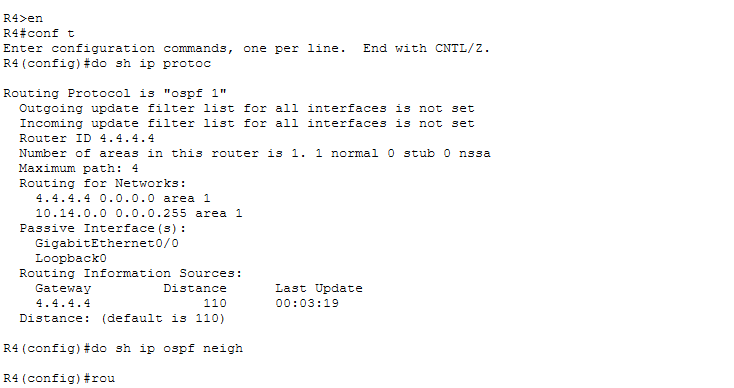

# OSPF Multi-Area Troubleshooting Lab

A practical Cisco Packet Tracer troubleshooting exercise focused on diagnosing and correcting OSPF issues across multiple areas. The lab scenario states that routers are not receiving the expected OSPF routes and that R5 is missing the expected `10.0.0.0/8` summary route.

The work below documents the issues found, the evidence used to identify them, the configuration changes made, and the verification performed. Screenshots are from the `Photos` folder in this directory.

## Lab overview

- **Platform:** Cisco Packet Tracer
- **Routing protocol:** OSPF, process ID 1
- **Routers involved:** R1, R2, R3, R4 and R5
- **Areas:** Area 0 (backbone), Area 1 and Area 2
- **Main objective:** Restore the required OSPF advertisements and adjacencies, and ensure R5 learns the expected inter-area summary route.

### Original topology and task

The topology is divided into three OSPF areas. The task specifically identifies missing OSPF routes and the missing `10.0.0.0/8` summary route on R5.


---

## Troubleshooting workflow

Each issue is documented using the same sequence:

**Symptom → Evidence → Root cause → Correction → Verification**

### 1. R1 — Loopback address not advertised into OSPF

**Symptom**

The loopback address `1.1.1.1` was not included in OSPF advertisements as required by the lab.

**Evidence and diagnosis**

I checked the OSPF configuration using `show ip protocols`. The routing network statements showed the existing Area 1 networks, but the loopback address needed an OSPF network statement in Area 0.


**Root cause**

The loopback interface address was not included in the OSPF process for Area 0.

**Correction**

Under OSPF process 1, I added the loopback host address:

```cisco
router ospf 1
 network 1.1.1.1 0.0.0.0 area 0
```

The `0.0.0.0` wildcard matches only the exact host address `1.1.1.1`.


**Verification**

The updated `show ip protocols` output displays `1.1.1.1 0.0.0.0 area 0` under Routing for Networks.

---

### 2. R2 — FastEthernet2/0 administratively down

**Symptom**

The R2–R3 link was not operational, preventing the expected connectivity and OSPF communication over that interface.

**Evidence and diagnosis**

I used:

```cisco
show ip interface brief
```

The output showed FastEthernet2/0 with the status **administratively down** and protocol **down**. This indicates that the interface had been manually disabled in the configuration.


**Root cause**

FastEthernet2/0 on R2 was administratively shut down.

**Correction**

I entered the interface configuration and enabled it:

```cisco
interface FastEthernet2/0
 no shutdown
```

**Verification**

The interface status changed from administratively down/down to an operational state after enabling it. The interface and routing information were then checked again.


---

### 3. R4 — OSPF adjacency prevented by a passive interface

**Symptom**

R4 was not forming the expected OSPF neighbor adjacency with R1 over GigabitEthernet0/0.

**Evidence and diagnosis**

I checked R4's OSPF configuration with:

```cisco
show ip protocols
```

The output listed GigabitEthernet0/0 under **Passive Interface(s)**. A passive OSPF interface can have its network advertised, but it does not send OSPF Hello packets on that interface. Therefore, it cannot form a neighbor adjacency over that link.



**Root cause**

GigabitEthernet0/0 on R4 was configured as a passive OSPF interface even though the link needed to establish an adjacency with R1.

**Correction**

I removed the passive-interface setting:

```cisco
router ospf 1
 no passive-interface GigabitEthernet0/0
```


**Verification**

After the change, the router generated an OSPF adjacency message showing the neighbor moving from LOADING to FULL:

```text
%OSPF-5-ADJCHG: Process 1, Nbr 1.1.1.1
on GigabitEthernet0/0 from LOADING to FULL
```

The updated protocol output no longer lists GigabitEthernet0/0 as a passive interface.


---

### 4. R3 — OSPF area mismatch on the R2–R3 link

**Symptom**

The OSPF adjacency over the R2–R3 link was not forming correctly. R3 was receiving OSPF packets that did not match the area configured for the corresponding link.

**Evidence and diagnosis**

The syslog messages on R3 explicitly reported an area mismatch:

```text
%OSPF-4-ERRRCV: Received invalid packet:
mismatch area ID, from backbone area must be
virtual-link but not found from 10.23.0.3
```

This message was the key diagnostic evidence. It indicated that the incoming OSPF packet was associated with the backbone area while the local link's OSPF area configuration did not match.


**Root cause**

The `10.23.0.0/24` network on R3 was assigned to Area 2, while the R2–R3 link was configured for Area 0 on the other side. OSPF neighbors on a common link must agree on the area ID.

**Correction**

I removed the incorrect Area 2 network statement and assigned the network to Area 0:

```cisco
router ospf 1
 no network 10.23.0.0 0.0.0.255 area 2
 network 10.23.0.0 0.0.0.255 area 0
```


**Verification**

The syslog output showed the R2 neighbor reaching FULL state on FastEthernet1/0. The updated `show ip protocols` output also showed `10.23.0.0/24` assigned to Area 0.

---

### 5. R3 — Summary range configured under the wrong OSPF area

**Symptom**

R5 was not receiving the expected `10.0.0.0/8` inter-area summary route.

**Evidence and diagnosis**

I inspected the OSPF configuration on R3 and found that the summary range was configured under Area 2:

```cisco
area 2 range 10.0.0.0 255.0.0.0
```

The range needed to summarize routes belonging to Area 0 toward the other OSPF area. The area specified in the range command determines which area's routes are summarized by the ABR.


**Root cause**

The summary range was associated with the wrong area on R3.

**Correction**

I removed the incorrect Area 2 range and configured the range under Area 0:

```cisco
router ospf 1
 no area 2 range 10.0.0.0 255.0.0.0
 area 0 range 10.0.0.0 255.0.0.0
```


**Verification on R5**

I checked the routing table on R5 using:

```cisco
show ip route
```

The output showed the expected inter-area route:

```text
O IA 10.0.0.0/8 [110/2000] via 10.35.0.3
```

- `O` indicates an OSPF-learned route.
- `IA` indicates an OSPF inter-area route.
- `10.0.0.0/8` is the expected summarized network.
- `10.35.0.3` is the next hop shown in the routing table.

This confirms that R5 received the expected summary route after the correction on R3.


---

## Final verification and outcome

The troubleshooting exercise covered five configuration issues across R1, R2, R3 and R4, followed by route verification on R5.

| Router | Issue | Verification evidence |
|---|---|---|
| R1 | Loopback address missing from OSPF Area 0 | `show ip protocols` lists 1.1.1.1 in Area 0 |
| R2 | FastEthernet2/0 administratively down | Interface enabled with `no shutdown` |
| R4 | G0/0 configured as passive | OSPF syslog reports neighbor 1.1.1.1 reaching FULL |
| R3 | R2–R3 network assigned to the wrong area | Syslog identifies mismatch; neighbor 2.2.2.2 reaches FULL after correction |
| R3 | Summary range configured under Area 2 instead of Area 0 | R5 routing table shows O IA 10.0.0.0/8 |

## Key troubleshooting skills demonstrated

- Interpreting OSPF syslog messages to identify adjacency and area mismatches.
- Checking interface states with `show ip interface brief`.
- Inspecting OSPF network statements and passive interfaces with `show ip protocols`.
- Understanding OSPF neighbor formation and the FULL adjacency state.
- Correcting OSPF area assignments on a shared link.
- Configuring inter-area route summarization on an ABR.
- Verifying learned routes and next hops using `show ip route`.

## Lab evidence

All screenshots used in this walkthrough are stored in the [Photos](./Photos/) directory.

**Result:** The identified OSPF configuration issues were corrected, the expected neighbor adjacencies reached FULL state, and R5 learned the expected `10.0.0.0/8` inter-area summary route.
